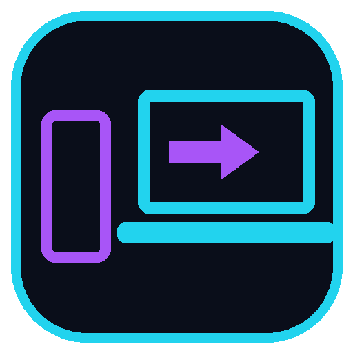

<h1 align="center">NexMirror</h1>

<b>Phone ki screen, laptop par.</b> Android screen poori laptop screen par, Wi-Fi se. Free Windows app by WSNex.

## Is repo mein
| File | Kya hai |
|---|---|
| `index.html`, `style.css`, `assets/` | Website (GitHub Pages, repo root se) |

## Naya version publish karna
- Windows: `download/NexMirror.exe` ko nayi file se replace karein (aur `index.html` mein version text).
- Android: GitHub -> **Releases** -> nayi release mein `NexMirror.apk` upload karein - website ka Android button khud ON ho jata hai.

Engine: [scrcpy](https://github.com/Genymobile/scrcpy) (Apache 2.0).
